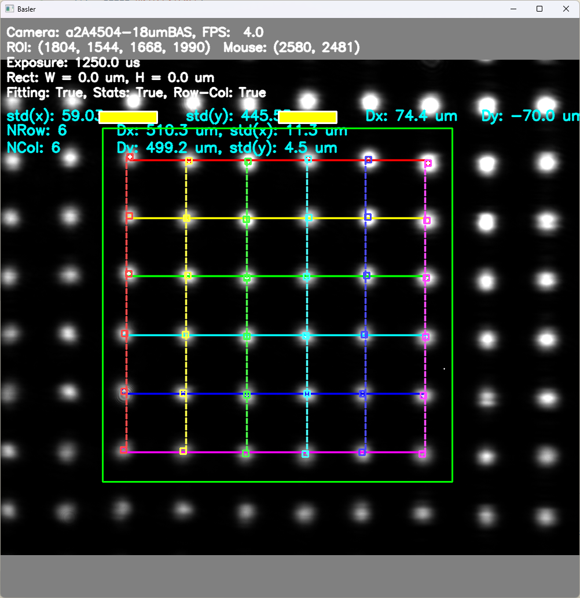

# Basler Beam Profiler

A Python application for live laser-beam profiling with Basler cameras - and
other GenICam cameras (FLIR, Allied Vision, IDS, ...) or USB webcams: spot
detection, sub-pixel 2D Gaussian fits, beam-array (grid) statistics, an HTTP
API and hardware sync outputs. Cameras can be plugged in, switched and
unplugged while it runs.



## Usage

On Ubuntu, `./setup.sh` creates a `.venv`, installs the requirements (plus
CuPy if an NVIDIA GPU is present; `--no-gpu` skips it, `--dev` adds
pytest/pyinstaller) and adds a **Beam Profiler** icon to the desktop and app
menu. `./run.sh` launches from the venv; started from the icon it logs to
`data/launcher.log`. Re-run `./setup.sh` after pulling new requirements.

Manually, in any environment:

```bash
pip install -r requirements.txt
python -m beam_profiler            # live camera (falls back to the simulator)
python -m beam_profiler --sim      # simulated camera, no hardware needed
python -m beam_profiler --camera 40615333   # start on this camera (serial/label/model)
python -m beam_profiler --ui-scale 1.5      # interface zoom for this session
python pylon_camera.py             # legacy entry point, same application
```

### Simulated camera

`--sim` (or having no camera connected) renders a fixed grid of Gaussian spots
with realistic noise in real time, so every CV function — blob detection,
Gaussian fitting, row/column statistics, auto-exposure — can be exercised
without hardware:

```bash
python -m beam_profiler --sim --sim-grid 8x8 --sim-jitter 0   # static 8x8 grid
python -m beam_profiler --sim --sim-size 4096x4096 --sim-grid 80x80   # dense array
```

The spot sigma defaults to pitch/10 (beam waist = 1/5 of the spot spacing);
override with `--sim-sigma <px>`.

Fixed spot pictures with ground-truth JSON (for offline testing) are generated
with:

```bash
python tools/make_test_images.py   # writes test_images/*.png/.npy/.json
```

### Architecture

```
beam_profiler/
├── __main__.py        CLI entry point
├── config.py          paths, constants, camera_config.yaml loading
├── synthetic.py       synthetic spot images (simulator, tests, tools)
├── roi.py             ROI zoom model + sensor<->display mapping
├── cameras/           base.py (Backend/Camera interface + auto-exposure),
│                      basler.py, genicam.py, uvc.py, simulated.py,
│                      manager.py (discovery, hot-plug), session.py (switch/reconnect)
├── processing/        blobs.py (detection + Gaussian fits), grid.py, stats.py
├── ui/                viewer.py (main loop, input), overlays.py (status bar, cards,
│                      toolbar, spots), gfx.py (cached text/panel sprites),
│                      icons.py (procedural icons), theme.py (shared palette),
│                      cameras_window.py, settings.py, tkhost.py (shared Tk thread)
├── server.py          Flask HTTP API
└── status.py          pylon_camera.json mirror
```

Spot detection runs on a ≤1024 px downscale of the frame and refines each spot
with a sub-pixel moment fit on a full-resolution crop, so even 25 MP sensors
profile at interactive rates.

### Tests

```bash
.venv/bin/python -m pytest   # after ./setup.sh --dev (or: pip install pytest; pytest)
```

The tests validate the CV pipeline against synthetic images with known ground
truth (positions, widths, orientation, grid classification).

### Configuring and adding cameras

Any camera the app enumerates will open, listed in `camera_config.yaml` or
not. The only value the application cannot discover for itself is the pixel
size, because cameras do not report it.

The quickest way to add one: plug it in while the app runs, press `k` for the
**Cameras** window, select it, enter the pixel size (µm) and press *Save*.
That writes `camera_config.yaml` for you, keeping its comments.

Or, from the command line, plug it in and ask what it is:

```bash
python -m beam_profiler --list-cameras        # report + a paste-ready YAML block
python -m beam_profiler --write-camera-config # create the file from scratch
```

`--list-cameras` prints the sensor size, the pixel formats, the exposure range,
the I/O lines and the trigger sources the camera actually has, then the
`camera_config.yaml` entry for it with everything but the pixel size filled in:

```yaml
cameras:
  a2A5060-15umBAS:        # the model name, exactly as pylon reports it
    pixel_size: 2.5e-6    # pixel pitch in metres - the only required setting
```

Settings can also be given for a whole family, or for one physical unit:

```yaml
defaults:                 # every camera
  max_exposure: 50000     # us
cameras:
  "a2A*BAS":              # a glob over the ace 2 family
    trigger_mode: auto    # auto | software | "off"
serials:
  "40615333":             # one camera, by serial number
    label: "profiler head, west arm"
    default_roi: [2048, 2048, 1500, 1500]   # [width, height, offset_x, offset_y]
```

More specific wins, field by field. Exposure limits, gain, pixel formats,
trigger mode and the two sync lines are all configurable this way, so an
unusual model needs no code change — `docs/cameras.md` is the full reference,
and `beam_profiler/cameraconfig.py` documents every setting inline.

Until a `pixel_size` is set, the app still runs and warns: the status bar shows
an amber *pixel size unset: µm = px* chip and `/api/status` reports
`"pixel_size_known": false`. Everything measured in pixels is unaffected.

### Using the compiled application

First clone this repo and set up `camera_config.yaml` (or run the executable
once with `--write-camera-config` to generate it).

Check release to download the latest version: [Releases](https://github.com/tim4431/Basler_Beam_Profiler/releases)

Put the `pylon_camera.exe` executable in the same directory as `camera_config.yaml`.
Saved frames (`data/`) and the live status file (`pylon_camera.json`) are written
next to the executable.

### The live view

- **Status bar** (top): a green/red dot for the camera on screen, its name and
  connection, how many other cameras are plugged in, and on the right the
  exposure (with an *AUTO* badge), the fit backend, the HTTP API and the sync
  output when they are on, and the frame rate.
- **Info card** (top left, `i` hides it): ROI, cursor position in sensor
  pixels, the white and green rectangles, and the fit settings in force.
  Below it, the white rectangle's pixel statistics while the HTTP API is on.
- **Statistics cards** (top right, `g` / `h`): spot spacing, scatter,
  curvature and width scatter, and the row/column figures for beam arrays.
  Changing numbers refresh about seven times a second, so they can be read.
- **Spots**: each fitted ellipse with its axes - red along `s0`, blue along
  `s1` - and, when it is big enough on screen, its centre (ROI pixels) and its
  widths `s0 × s1` in µm (2σ, see [docs/fitting.md](docs/fitting.md)).
- **Toolbar** (bottom): icon buttons for everything on the keyboard - fit,
  statistics, rows & columns; auto exposure and exposure −/+ (shift-click:
  ÷10/×10); clear rectangles; Cameras window and next camera; sync output and
  HTTP API; save (shift-click: save as); info panel, fit settings and help.
  Active buttons are blue, buttons that would do nothing right now are dimmed,
  and hovering one shows its name and shortcut.
- `?` (or F1) shows every shortcut on one card.

The window can be resized to any shape: the picture is drawn at the window's
real size (no blurry upscaling), the toolbar stays centred and the cards stay
in their corners. **Interface zoom** - `+` / `-` in the live view, `0` for
100 %, or Ctrl `+` / `-` / `0` in the Settings and Cameras windows, or the
*Interface* section of the Settings window - scales text, panels, icons and
lines everywhere from 50 to 250 %. The zoom and the window size are remembered
in `ui_config.json` next to the app; `--ui-scale 1.5` overrides the zoom for
one session. On a window too small for the chosen zoom, the cards and the
toolbar shrink just enough to fit.

Closing the window (title-bar X) quits the application, same as `Esc`.
Pillow (in requirements.txt) draws the text; without it the overlays fall back
to OpenCV's built-in font.

### Cameras: switching, hot-plugging, other vendors

The app watches for cameras in the background. Plugging one in shows a
"Camera connected" message and lists it in the **Cameras** window (`k`), where
a double-click switches to it; `t` cycles through the connected cameras. Each
camera keeps its own ROI, exposure and rectangles.

Unplugging the camera in use does not end the program: the picture dims under
a *Camera disconnected* banner, and when the camera comes back it is reopened
with all its settings. Started with no camera attached, the app shows the
simulator and switches to the first real camera you plug in.

Besides Basler (pylon), the app supports GenICam cameras from other vendors
through [`harvesters`](https://github.com/genicam/harvesters) (`pip install
"harvesters>=1.4"` plus the vendor's SDK for its GenTL producer) and USB
webcams through OpenCV. See [docs/cameras.md](docs/cameras.md#camera-types).

### Keyboard Shortcuts

Every toolbar button names its shortcut when hovered, and `?` lists them all.

- `Esc`: Quit the application (or close the window); closes the help card first if it is open
- `arrow keys`: up/down=change exposure by 10 times, left/right=change exposure by 10%
- `a`: toggle auto-exposure (auto exposure adjusts the exposure time to keep the max intensity to be near-saturated)
- `f`: toggle blob fitting
- `g`: toggle statistics showing (statistics of fitted blobs)
- `h`: toggle row/col statistics (works only for beam arrays)
- `mouse drag`: create a white rectangle in the canvas
- `c`: clear the white rectangle
- `ctrl + mouse drag`: create a green rectangle in the canvas, only blobs inside the rectangle will be fitted
- `v`: clear the green rectangle
- `s`: quick save the current frame (JPEG + raw `.npy`)
- `d`: save the current frame with dialogue box, allowing the user to choose the file location and name
- `t`: switch to the next connected camera
- `k`: open the Cameras window (every camera found, switch with a double-click, set label and pixel size)
- `o`: open the Settings window (spot fit: crop size, re-crop stages, adaptive weighting, GPU backend; interface zoom)
- `w`: toggle the HTTP server (port 5000), together with the live pixel statistics of the white rectangle drawn on the canvas
- `y`: toggle the user-defined line output (Line3) used to sync external hardware
- `mouse wheel`: zoom in/out the canvas (`ctrl + wheel`: change aspect ratio)
- `i`: show/hide the info card (ROI, cursor, rectangles, fit settings)
- `?` or `F1`: show/hide the card listing every shortcut
- `+` / `=` and `-`: interface zoom in / out (10 % steps, 50-250 %); `0`: back to 100 %

## Spot fitting settings

Press `o` for a settings window covering every parameter of the fit: the crop
size, how many times the crop is re-derived from the fitted width, whether to
use adaptive Gaussian weighting, and the CUDA backend. Changes take effect on
the next frame and persist to `fit_config.json` next to the app; the same
values are readable and writable over HTTP at `/api/fit_config`.

Each control explains itself in the help pane. The defaults are measured
optima rather than guesses. [`docs/fitting.md`](docs/fitting.md) walks through
the fitting method step by step, and
[`docs/fitting-calibration.md`](docs/fitting-calibration.md) records the sweeps
behind each default - the test suite re-runs those measurements.

## Remote control / readout

Pressing `w` starts a small HTTP server on port 5000 that exposes the camera
status, the current frame, and the pixel statistics of the white / green
rectangles; `/api/cameras` lists the cameras and `/api/select_camera` switches
between them. Open <http://localhost:5000> for the endpoint list, or see
[docs/web_api.md](docs/web_api.md) for the full reference.

The current state (camera, exposure, ROI, rectangles) is also mirrored to
`pylon_camera.json` whenever it changes, so another process can read it without
starting the server.

## Hardware sync

Basler cameras are armed with a software trigger, and drive two GPIO lines:

- **Line2** - inverted `ExposureActive`, i.e. it mirrors the exposure window.
- **Line3** - user-controlled output, toggled with `y`. While enabled it is
  pulsed low for the duration of each acquisition.

Cameras that do not expose these lines (or the software trigger) log a warning at
startup and keep running with that feature disabled.
